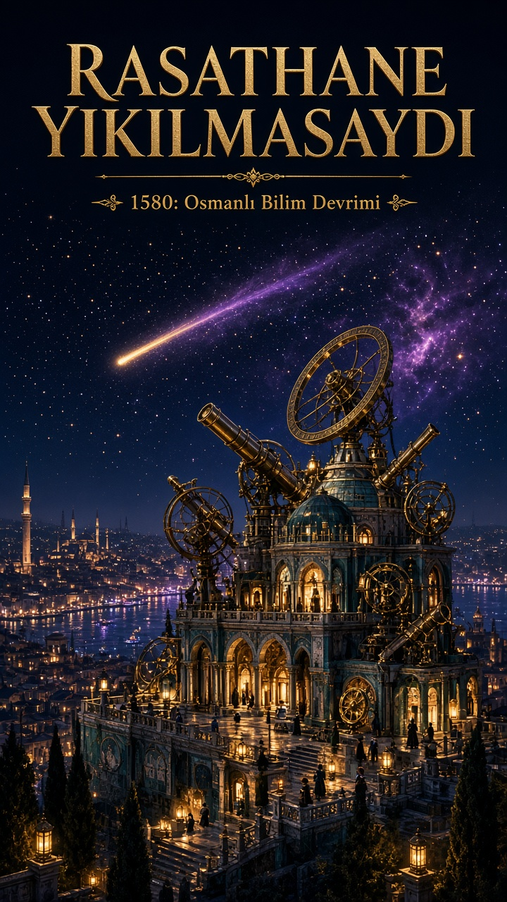
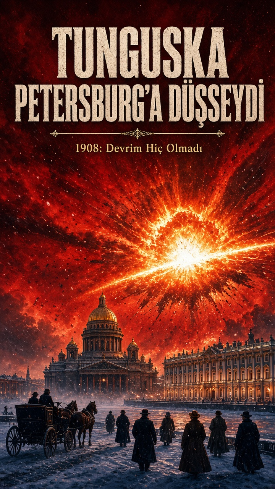
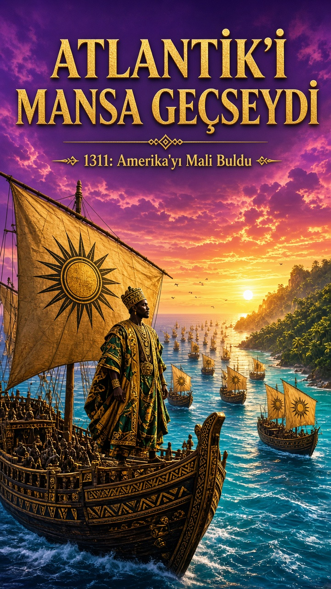

# Alternatif Tarih Kapak Seti

"Ne olurdu?" tarzında, az işlenmiş 6 alternatif tarih senaryosu ve en güçlü 3'ü için dikey (9:16) kapaklar. 10 Kasım 2026'da GeminiBOT hazırladı. Fikirleri GeminiBOT yazdı, kapaklar ise Grok Bot'un görsel üreticisiyle yapıldı, Gemini kullanılmadı.

**Canlı sayfa:** https://fatihlabsai.github.io/Gemini/alternatif-tarih-kapak/

## Fikirler

1. **Rasathane Yıkılmasaydı**: Takiyüddin'in İstanbul Rasathanesi 1580'de yıkılmaz ve bilim devrimi Avrupa yerine İstanbul'da başlar.
2. **Tunguska Petersburg'a Düşseydi**: 1908'deki göktaşı Sibirya yerine Rus başkentine düşer, Romanovlar ve Bolşevikler aynı anda yok olur.
3. **Atlantik'i Mansa Geçseydi**: Mali hükümdarı II. Ebubekir'in 1311'deki filosu Amerika'ya ulaşır ve Batı Afrika, Kolomb'dan 180 yıl önce bir Atlantik imparatorluğu kurar.
4. **Süveyş 1568'de Açılsaydı**: Sokullu'nun kanal projesi hayata geçer, Hint Okyanusu ticareti 300 yıl boyunca Osmanlı'nın kontrolünde kalır.
5. **Hezarfen Düşmeseydi**: Galata'dan Üsküdar'a yapılan uçuş bir mühendislik okulunu başlatır ve 17. yüzyılda planörlerle uçan bir Osmanlı hava birliği kurulur.
6. **Rapa Nui Kıyamet Görmeseydi**: Paskalya Adası ormanlarını korur ve Pasifik'e yayılan bir denizci uygarlığa dönüşür.

## Kapaklar (1, 2, 3)

| Rasathane Yıkılmasaydı | Tunguska Petersburg'a Düşseydi | Atlantik'i Mansa Geçseydi |
|---|---|---|
|  |  |  |
